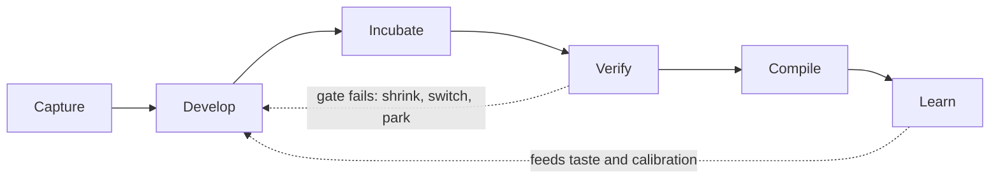
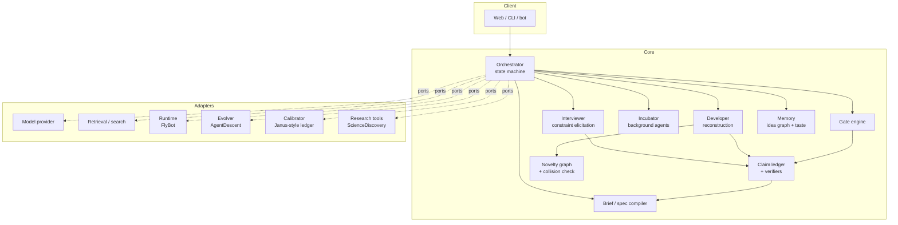

<p align="center">
  <picture>
    <source media="(prefers-color-scheme: dark)" srcset="docs/images/latent-wordmark-dark.svg">
    
  </picture>
</p>

<p align="center">
  <b>Turn fragments into whole ideas.</b><br>
  Capture the half-thought. Latent reconstructs it, shows what it guessed, verifies what it can, and compiles it into something you can act on.
</p>

<p align="center">
  <a href="https://github.com/HugoXK/latent/actions/workflows/ci.yml"></a>
  <a href="LICENSE"></a>
  
  
  
</p>

<p align="center">English | <a href="README.zh.md">中文</a> · <a href="docs/vision.md">Vision</a> · <a href="docs/architecture.md">Architecture</a> · <a href="docs/prior-art.md">Prior art</a></p>

---

> **Status:** `v0.2.0-alpha.0` is an early, working vertical slice. It ships the
> core state machine, the claim ledger, the gate engine, the brief compiler, an
> information-gain interviewer, a SQLite store, a CLI, a local Fastify API and the
> iGEM pack. Reconstruction is a
> deterministic template, **not a model**; a real model adapter is next. Nothing
> here claims a production agent, and the schemas and decisions remain the
> contract the runtime is held to.

Latent is an **evidence-driven idea development platform**. It is not an idea
generator. Most tools optimise for producing more text; Latent optimises for the
thing a person actually needs after a good idea arrives half-formed: **a version
they can see, question, test, and act on.**

You wake up with three keywords. Latent gives you three candidate reconstructions,
the assumptions it had to make, the confidence behind each one, the questions that
would collapse the uncertainty fastest, and a one-page brief you can hand to a
person or an agent.

## Table of contents

- [Why Latent](#why-latent)
- [What it is](#what-it-is)
- [What it is not](#what-it-is-not)
- [The loop](#the-loop)
- [Five primitives](#five-primitives)
- [How it works](#how-it-works)
- [Quick start](#quick-start)
- [Design principles](#design-principles)
- [Verticals](#verticals)
- [Prior art and evidence](#prior-art-and-evidence)
- [Evaluation](#evaluation)
- [Repository layout](#repository-layout)
- [Roadmap](#roadmap)
- [Security and privacy](#security-and-privacy)
- [FAQ](#faq)
- [Contributing](#contributing)
- [License](#license)
- [Built with](#built-with)

## Why Latent

Implementation is getting cheap. The scarce things are now **articulation,
judgement, verification and follow-through**:

- A fragment in your head is not yet an idea; it has no edges, no assumptions, no
  test.
- A generic model will happily invent the missing parts and hide that it did.
- A note-taking app will store the fragment forever and never develop it.
- An autonomous agent will run with a guess you never approved.

Latent exists to close exactly that gap. The name comes from the photographic
**latent image**: after the shutter, the picture is already on the film, invisible
until the developer brings it out. An idea is like that. The job is not to invent a
different picture; it is to develop the one that is already there, and to show the
grain honestly.

- English tagline: **Don't generate. Develop.**
- Chinese tagline: **不替你造，只帮你显。**

See [docs/decisions/0001-name.md](docs/decisions/0001-name.md) for the naming
decision, the candidates, and the fallbacks.

## What it is

- A **capture-first workspace** for fragments: text, voice, images, links, sketches.
- A **reconstruction engine** that turns an incomplete thought into a small set of
  explicit hypotheses, each with an assumption ledger and a confidence.
- An **interviewer** that asks the highest-information-gain constraint question,
  with a blocking set that must be answered before verification.
- An **evidence ledger** where every claim is either sourced, marked as inferred,
  or marked unknown. No claim silently becomes a fact.
- A **portfolio of gates** — falsifiers, controls, and go/no-go rules — that a
  human can inspect and decide on.
- A **compiler** that emits a one-page brief or an executable spec for a person, a
  coding agent, or a research team.
- A **longitudinal memory** of what you believed, what you shipped, and how it
  turned out, so the next idea starts from your taste, not the model's average.

## What it is not

- **Not an idea factory.** More ideas is not the goal; a better-developed idea is.
- **Not a chatbot with a template.** The ledger, the gates and the provenance are
  the product; the prose is an output.
- **Not an autonomous decision-maker.** Latent proposes; a human approves every
  gate that changes scope, spend or risk.
- **Not a code runner.** It compiles a spec for a runtime; it does not execute
  your repository.
- **Not a replacement for a domain expert.** In high-stakes verticals it is a
  research and structuring tool, with the human as the reviewer of record.

## The loop



1. **Capture** — one keystroke or one voice note. Structure is optional.
2. **Develop** — reconstruct into 1–3 hypotheses; list every assumption; ask the
   question with the highest expected information gain.
3. **Incubate** — background agents connect the fragment to new evidence, prior
   fragments, and each other. Ideas are allowed to wait.
4. **Verify** — retrieve sources, run cheap experiments, red-team the mechanism,
   and score each gate with a falsifier and a fallback.
5. **Compile** — emit a brief or a spec with numbers, units, conditions, risks and
   an explicit "what we still don't know".
6. **Learn** — record what was approved, what failed, and why; calibrate the next
   reconstruction against the outcome.

## Five primitives

Every vertical is a configuration of the same five objects. They are versioned as
JSON Schema in [`data/schemas/`](data/schemas/).

| Primitive | What it holds | Why it exists |
|---|---|---|
| **Fragment** | A raw capture: text, voice, image, link, sketch, with provenance. | Ideas arrive before structure. Capture must not demand structure. |
| **Idea** | Hypotheses, assumptions, open questions, status and version. | The unit that can be developed, parked, killed or promoted. |
| **Claim** | A statement with value, unit, conditions, sources, status and confidence. | Separates what is known from what the model guessed. |
| **Gate** | A falsifier, controls, evidence and a go/no-go decision. | Makes "is this worth doing?" inspectable instead of rhetorical. |
| **Brief** | A compiled, one-page or one-spec output with risks and unknowns. | The handoff to a person, a coding agent or a research team. |

Confidence follows the vertical's evidence scale. In the iGEM vertical it is
`A` (peer-reviewed characterisation), `B` (registry or team-wiki data only) and
`C` (sequence only, no functional data). A `C` component is budgeted as "we must
re-characterise it", never as "we can use it". See
[docs/vertical-igem.md](docs/vertical-igem.md).

## How it works



The core is a **state machine**, not a prompt chain. Every transition has an exit
condition, every artifact is versioned, and every claim is traceable to a source
or explicitly marked `unknown`. The full design, trust boundaries and failure
modes are in [docs/architecture.md](docs/architecture.md).

## Quick start

Requirements: **Node 22.9+**, **pnpm 11+**, and Python 3.10+ (only for schema
validation). The store uses `node:sqlite`, so Node 22.9+ is required.

```sh
git clone https://github.com/HugoXK/latent.git
cd latent
pnpm install

# Validate the JSON schemas (stdlib only).
python3 - <<'PY'
import glob, json
for path in glob.glob("data/schemas/*.schema.json"):
    with open(path, encoding="utf-8") as fh:
        json.load(fh)
    print("ok", path)
PY

# Offline vertical slice: fragment -> develop -> confirm -> decide -> brief.
export LATENT_DB_PATH=/tmp/latent-demo.sqlite
pnpm latent capture "用土壤菌群做重金属现场检测，但读出还不清楚"
pnpm latent develop <fragment-id>
pnpm latent ask <idea-id>                    # the next highest-information question
pnpm latent answer <idea-id> lab.bsl 1       # answer a blocking constraint
pnpm latent constraints <idea-id>            # what is still unknown or blocking
pnpm latent constraints undo <idea-id>       # undo the last answer as a new version
pnpm latent confirm <idea-id> --all          # a human decision, recorded
pnpm latent decide <idea-id> --all pass --reason "design partner pilot"
pnpm latent brief <idea-id>                  # refuses if a constraint, gate or assumption blocks
pnpm latent memory search "biosensor"        # find fragments and ideas
pnpm latent novelty <idea-id> --input prior-art.json  # collision report with claim/source links
pnpm latent ingest corpus.json                 # snapshots + local index
pnpm latent retrieve "arsenic biosensor"       # BM25 + vector hits with provenance
pnpm latent memory connect <fragment-id> <idea-id>  # explain the path
pnpm latent memory export                    # open JSON graph; delete blocks on references
pnpm latent outcome <idea-id> tested --success --confidence 0.62  # realised result (human)
pnpm latent calibration                      # Brier, log loss and missing outcomes
pnpm latent priors                           # empirical option priors from outcomes
pnpm latent incubate <fragment-id> --budget 5  # propose connections within a budget
pnpm latent suggestions --status proposed      # review suggestions
pnpm latent digest                            # read-only weekly view
```

The CLI contract is specified in [docs/api.md](docs/api.md). Every command accepts
`--json` and returns a stable `{ ok, command, data }` envelope or a
`{ ok, command, error }` envelope on stderr. The default reconstructor is a
deterministic template so the pipeline is testable without a provider.

### Local UI

`pnpm dev` serves a no-build UI at <http://127.0.0.1:4310/>. The shell is public;
the page asks for the bearer token from `data/runtime/auth-token` (or
`LATENT_AUTH_TOKEN`) and sends it on every API call. The flow is capture →
interview → assumption ledger → gate board → brief, with JSON and Markdown export.

### Using a model

`ModelReconstructor` implements the same port and speaks the OpenAI-compatible
chat-completions API:

```sh
export LATENT_RECONSTRUCTOR=model
export LATENT_MODEL_BASE_URL=https://api.openai.com/v1
export LATENT_MODEL_API_KEY=...
export LATENT_MODEL_NAME=...
# Private fragments are refused unless you opt in:
export LATENT_MODEL_SEND_PRIVATE=true
pnpm latent develop <fragment-id>
```

The adapter enforces a strict contract: three variants, non-empty assumptions and
claims, only `inferred`/`unknown` claims, and `confidence_basis: "C"`. A `verified`
claim is rejected and repaired once; a second failure stops the job. There is no
silent fallback to the template. A model is not a source; the ledger upgrades a
claim only when a real source supports it.

Read the spec in this order:

1. [docs/vision.md](docs/vision.md) — the problem and the thesis.
2. [docs/architecture.md](docs/architecture.md) — components, state machine, ports.
3. [docs/prior-art.md](docs/prior-art.md) — what exists, and why this is different.
4. [docs/vertical-igem.md](docs/vertical-igem.md) — the first end-to-end vertical.
5. [docs/roadmap.md](docs/roadmap.md) — what ships next and how it is judged.

## Design principles

1. **Cite or abstain.** A claim without a source is `inferred` or `unknown`.
   Never dress a gap in a fluent sentence.
2. **Assumptions are first-class.** Every reconstruction lists what it had to
   invent. The user can confirm, correct or delete each assumption.
3. **Confidence is calibrated, not asserted.** Track predicted confidence against
   real outcomes; prefer `defer` to a confident answer with no evidence.
4. **Human decides.** Models propose; humans approve anything that changes scope,
   spend, safety or publication.
5. **Anti-homogenisation.** Enforce multi-persona, cross-domain and adversarial
   passes. LLM ideas are measurably less diverse at the set level.
6. **Local-first and private.** Thoughts are sensitive. Encrypt at rest, redact
   logs, and make export a first-class feature.
7. **Ports, not dependencies.** Runtime, model, search, evolution and calibration
   are adapters. The core does not require any one vendor.

The reasoning behind each principle is in [docs/vision.md](docs/vision.md) and the
ADRs under [docs/decisions/](docs/decisions/).

## Verticals

The core is domain-agnostic; a vertical supplies the interviewer's variables, the
evidence scale, the gates and the compiler template.

| Vertical | Status | What it adds |
|---|---|---|
| **iGEM topic selection** | Spec (`v0.1`) | Constraints (BSL, equipment, budget, term-time), Registry/parts review, A/B/C evidence, DBTL feasibility, medal strategy |
| Research proposal | Planned | Literature collision, hypothesis specification, feasibility and ethics gates |
| Startup idea | Planned | Demand evidence, competitive scan, unit economics, MVP spec |
| Grant / fellowship | Planned | Funder fit, novelty, methods, budget and timeline gates |

The iGEM vertical is the first because it has a clear objective function, a
semi-structured corpus, and an annual evaluation cycle. See
[docs/vertical-igem.md](docs/vertical-igem.md).

## Prior art and evidence

Latent is built on a simple reading of the evidence:

- LLM ideas are often judged **more novel but less feasible** than expert ideas
  ([Si et al., 2024](https://arxiv.org/abs/2409.04109)).
- LLM product ideas can be higher quality on average but are **less novel and
  less diverse at the set level** ([2026 study](https://arxiv.org/abs/2607.27553)).
- Recovering a true research idea from only its pre-publication bibliography is
  still hard: frontier models match roughly **3–15%** of the time
  ([Reconstruction, 2026](https://arxiv.org/abs/2608.16645)).
- A novel idea can still be **under-specified for implementation**; that gap now
  has its own benchmark ([IdeaAMBIG, 2026](https://arxiv.org/abs/2609.10539)).
- Multi-agent critique improves diversity and feasibility
  ([2025](https://arxiv.org/abs/2507.08350)).

The full landscape — sibling projects (Fledge, Janus, AgentDescent,
ScienceDiscovery, FlyBot), external products, and the academic record — is in
[docs/prior-art.md](docs/prior-art.md).

## Evaluation

A development platform that cannot be evaluated is a demo. Latent is judged on
four levels:

| Level | Metric | Target |
|---|---|---|
| Claim integrity | Unsupported claims in a compiled brief | `0` |
| Reconstruction | Assumptions the user accepts without editing | `> 60%` |
| Verification | Gate verdicts agreeing with an expert panel | `> 75%` |
| Outcome | Ideas that reach a decided state (shipped, tested, parked, killed) | tracked, not vanity |

Evaluation is described in [docs/roadmap.md](docs/roadmap.md). The first benchmark
is a blind replay of historical iGEM projects: given only pre-season information,
does Latent recover a viable topic and the right collision report? The case format
and fixtures live in [`data/replay/`](data/replay/); validate a case with
`pnpm latent eval validate <file>`.

## Repository layout

| Path | What it is |
|---|---|
| `README.md`, `README.zh.md` | The public contract and the quick tour |
| `docs/vision.md` | Problem, thesis, principles, non-goals |
| `docs/architecture.md` | Components, state machine, ports, failure modes |
| `docs/prior-art.md` | Sibling projects, external products, academic evidence |
| `docs/vertical-igem.md` | The first vertical, end to end |
| `docs/api.md` | REST and CLI contract |
| `docs/security.md` | Threat model and data handling |
| `docs/release.md` | Two-phase release: PR, tag, SBOM, provenance |
| `docs/replay-plan.md` | Five illustrative cases and the 20-case evaluation plan |
| `docs/runtime.md` | FlyBot-compatible runtime contract and callbacks |
| `docs/decisions/` | Architecture decision records |
| `data/schemas/` | JSON Schema 2020-12 for the five primitives |
| `packages/core/` | State machine, ledger, gates, compiler, ports |
| `packages/store/` | SQLite store (`node:sqlite`), events, counts |
| `packages/adapters/` | Deterministic reconstructor and offline fakes |
| `packages/vertical-igem/` | The iGEM pack as runtime data |
| `packages/vertical-research/` | The research-proposal pack |
| `packages/verticals/` | The pack registry (`igem`, `research`) |
| `apps/cli/` | The `latent` CLI |
| `apps/server/` | Local Fastify API |
| `openapi/` | The committed OpenAPI 3.1 contract |
| `packages/client/` | Typed client for the local API |
| `verticals/igem/` | iGEM vertical notes and the one-page template |
| `pnpm-workspace.yaml`, `pnpm-lock.yaml` | The workspace and the locked dependency graph |
| `AGENTS.md` | Binding rules for AI agents working on this repo |
| `LESSONS.md` | Dated, open constraints |

The runtime layout is specified in [docs/architecture.md](docs/architecture.md).

## Roadmap

| Version | Focus | Exit criteria |
|---|---|---|
| `v0.1` | Spec: schemas, architecture, iGEM vertical, evaluation plan | Schemas validate; docs reviewed; three design partners interviewed |
| `v0.2` | **Alpha shipped**: capture + interview + develop + gates + brief, SQLite, CLI, API, iGEM pack, model adapter | A user can go from fragment to brief with zero unsupported claims; ten real fragments is the remaining exit criterion |
| `v0.3` | Verify: retrieval adapters, novelty graph, gate engine, red team | Gate verdict agrees with experts on 20 replayed projects |
| `v0.4` | Incubate: background agents, resurfacing, memory, taste model | Weekly resurfacing produces at least one accepted connection per active user |
| `v0.5` | Ecosystem: FlyBot runtime, AgentDescent evolution, Janus calibration, ScienceDiscovery tools | One vertical runs end to end on the shared stack |
| `v1.0` | Team workspaces, Postgres, public API, vertical SDK | D30 retention and a paid pilot with a real team |

Full workstreams, open questions and exit criteria: [docs/roadmap.md](docs/roadmap.md).

## Security and privacy

Thoughts are among the most sensitive data a person has. Latent is **local-first**
by default, encrypts secrets at rest, redacts logs, and never sends a private
fragment to a third-party model without an explicit, per-provider setting.

- No secrets in git; `.env` is ignored; logs are redacted.
- Retrieved content is treated as **untrusted**; it cannot rewrite the ledger or
  the gates.
- Science verticals carry a biosafety and dual-use classifier; unsafe directions
  are refused, not softened.
- A compiled brief always shows what is inferred, what is sourced and what is
  unknown.

Report a vulnerability privately: see [SECURITY.md](SECURITY.md). The full model
is in [docs/security.md](docs/security.md).

## FAQ

**Is this just ChatGPT with a template?**
No. The value is the ledger, the gates, the provenance and the memory. A chat
model can write the prose; it cannot tell you which sentences it invented, which
assumptions are load-bearing, or which gate your idea fails.

**Does it generate ideas for me?**
It can propose, but the product is designed to **develop** what you bring. If you
want volume, any model will give you volume. Latent optimises for a version you
can defend.

**Why start with iGEM?**
It has a hard objective (a medal, one DBTL loop), a semi-structured corpus
(Registry, team wikis, papers), and a yearly cadence for evaluation. It is a
forcing function for honesty.

**Will it work for startups or research proposals?**
The core is domain-agnostic. A vertical is a configuration of variables, evidence
scales, gates and a compiler template. iGEM is first because it is the strictest
small world we could find.

**Is it open source?**
Apache-2.0. See [LICENSE](LICENSE).

**Does it run locally?**
The target is local-first: a single-writer SQLite store and your own model keys.
A hosted version is optional, not required.

## Contributing

Contributions are welcome when they follow [CONTRIBUTING.md](CONTRIBUTING.md),
[AGENTS.md](AGENTS.md) and [docs/code-standards.md](docs/code-standards.md).

- One issue, one branch, one PR.
- `main` is protected: a PR needs `ci-ok`, `pr-lint` and a `review-gate` PASS from
  `HugoXK-bot` at the tip. See [docs/review.md](docs/review.md).
- Schemas are the source of truth; a schema change needs an ADR and a migration note.
- Bilingual READMEs and user-facing copy stay in step.
- Never commit secrets. Never open a public issue with exploit detail.

## License

[Apache-2.0](LICENSE). By contributing you agree that your contribution is licensed
under the same terms (section 5 of the licence).

## Built with

TypeScript and Node 22.9+; SQLite via `node:sqlite`; JSON Schema 2020-12; and the
sibling projects it is designed to plug into —
[FlyBot](https://github.com/ThinkFlowLab/FlyBot) as a runtime,
[AgentDescent](https://github.com/ThinkFlowLab/agentdescent) as an offline evolver,
[Janus](https://github.com/HugoXK/janus) as a calibration reference, and
[ScienceDiscovery](https://github.com/HugoXK/sciencediscovery) as a research-tool
adapter.

---

<p align="center"><sub>Latent / 显影 · turn fragments into whole ideas · Don't generate. Develop.</sub></p>
