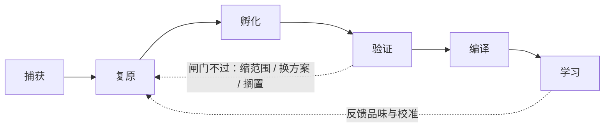
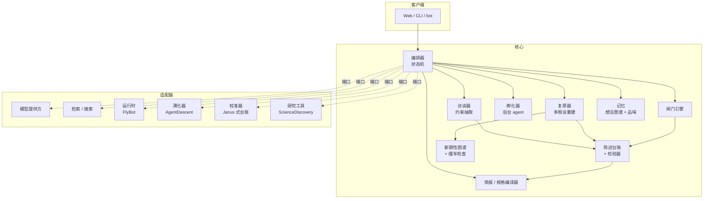

<p align="center">
  <picture>
    <source media="(prefers-color-scheme: dark)" srcset="docs/images/latent-wordmark-dark.svg">
    
  </picture>
</p>

<p align="center">
  <b>把碎片，补全成完整的想法。</b><br>
  记下那句没说完的话。显影帮你复原它，标出它猜了什么，验证它能验证的，再编译成你可以动手的东西。
</p>

<p align="center">
  <a href="https://github.com/HugoXK/latent/actions/workflows/ci.yml"></a>
  <a href="LICENSE"></a>
  
  
  
</p>

<p align="center"><a href="README.md">English</a> | 中文 · <a href="docs/vision.md">愿景</a> · <a href="docs/architecture.md">架构</a> · <a href="docs/prior-art.md">已有工作</a></p>

---

> **状态：** `v0.2.0-alpha.0` 是一个可运行的早期垂直切片。它包含核心状态机、陈述台账、闸门引擎、简报编译器、信息增益访谈器、SQLite 存储、CLI、本地 Fastify API 和 iGEM pack。复原器是确定性模板，**不是模型**；真正的模型适配器是下一步。这里不宣称生产级 agent；Schema 与决策记录仍是运行时必须遵守的契约。

**显影（Latent）是一个证据驱动的想法开发平台，不是想法生成器。** 大多数工具优化“产出更多文本”；显影优化的是一个人在半成品想法出现之后真正需要的东西：**一个看得见、问得动、测得了、能动手的版本。**

你醒来只记得三个关键词。显影给你三个候选复原，列出它不得不做的假设，给出每个版本的置信度，告诉你哪个问题最能快速消除不确定性，最后编译成一页纸的简报，交给一个人或一个 agent。

## 目录

- [为什么是显影](#为什么是显影)
- [它是什么](#它是什么)
- [它不是什么](#它不是什么)
- [核心闭环](#核心闭环)
- [五个原语](#五个原语)
- [它如何工作](#它如何工作)
- [快速开始](#快速开始)
- [设计原则](#设计原则)
- [垂直场景](#垂直场景)
- [已有工作与证据](#已有工作与证据)
- [评估](#评估)
- [仓库结构](#仓库结构)
- [路线图](#路线图)
- [安全与隐私](#安全与隐私)
- [FAQ](#faq)
- [贡献](#贡献)
- [许可证](#许可证)
- [构建于](#构建于)

## 为什么是显影

实现正在变便宜。现在稀缺的是四件事：**把想法说清、判断值不值得、验证真假、以及把它做完。**

- 脑子里的碎片还不是想法：没有边界，没有假设，没有测试。
- 通用模型会很乐意替你编出缺失的部分，并且不告诉你它编了。
- 笔记软件会把碎片永远存着，但从不替你发展它。
- 自主 agent 会带着一个你从未批准的猜测一路狂奔。

显影就是为了补上这段差距。名字来自胶片的**潜影**：按下快门之后，影像已经在底片上，只是肉眼看不见，直到显影液让它浮现。想法也是这样。我们要做的不是另造一张图，而是把已经存在的那张显出来，并且诚实地保留颗粒感。

- 中文主张：**不替你造，只帮你显。**
- 英文主张：**Don't generate. Develop.**

命名决策、候选名和备选方案见 [docs/decisions/0001-name.md](docs/decisions/0001-name.md)。

## 它是什么

- 一个**捕获优先**的工作区：文字、语音、图片、链接、草图。
- 一个**复原引擎**：把不完整的想法变成少量显式假设，每个假设都带假设台账和置信度。
- 一个**访谈器**：按期望信息增益提问；未回答的 blocking 约束会阻止进入验证。
- 一个**证据台账**：每条陈述要么有来源，要么标为推断，要么标为未知。没有陈述会悄悄变成事实。
- 一组**闸门**：证伪条件、对照、go/no-go 规则，人可以逐条检查并决定。
- 一个**编译器**：输出一页纸简报，或一份可执行规格，交给一个人、一个 coding agent 或一个研究团队。
- 一份**纵向记忆**：记录你相信过什么、做成了什么、结果如何，让下一个想法从你的品味出发，而不是从模型的平均值出发。

## 它不是什么

- **不是想法工厂。** 目标不是更多想法，而是被更好地发展的想法。
- **不是套了模板的聊天机器人。** 台账、闸门和溯源才是产品；文字只是输出。
- **不是自主决策者。** 显影只提议；任何改变范围、花费、安全或发布的闸门都由人批准。
- **不是代码执行器。** 它为运行时编译规格，不执行你的仓库。
- **不是领域专家的替代品。** 在高风险垂直场景里，它是研究与结构化工具，人始终是署名评审者。

## 核心闭环



1. **捕获** —— 一次按键、一段语音。结构可选。
2. **复原** —— 复原成 1–3 个假设；列出每一个假设；问那个期望信息增益最高的问题。
3. **孵化** —— 后台 agent 把碎片与新证据、旧碎片、彼此连接起来。想法允许等待。
4. **验证** —— 检索来源、做便宜实验、红队攻击机制，用证伪条件和备用方案给每个闸门打分。
5. **编译** —— 输出简报或规格，带数字、单位、条件、风险和明确的“还没搞清”。
6. **学习** —— 记录什么被批准、什么失败、为什么；用结果校准下一次复原。

## 五个原语

每个垂直场景都是同一组对象的配置。它们以 JSON Schema 版本化，放在 [`data/schemas/`](data/schemas/)。

| 原语 | 承载什么 | 为什么存在 |
|---|---|---|
| **Fragment（碎片）** | 原始捕获：文字、语音、图片、链接、草图，带来源。 | 想法先于结构到达；捕获不能要求结构。 |
| **Idea（想法）** | 假设、假设台账、开放问题、状态、版本。 | 可以被发展、搁置、杀掉或提升的基本单位。 |
| **Claim（陈述）** | 带数值、单位、条件、来源、状态、置信度的陈述。 | 把“已知”和“模型猜的”分开。 |
| **Gate（闸门）** | 证伪条件、对照、证据、go/no-go 决策。 | 让“值不值得做”可检查，而不是靠修辞。 |
| **Brief（简报）** | 编译后的一页纸或一份规格，带风险和未知。 | 交给一个人、一个 coding agent 或一个研究团队。 |

置信度遵循垂直场景的证据刻度。在 iGEM 里是 `A`（同行评议表征数据）、`B`（只有 Registry 或队伍 wiki 数据）、`C`（只有序列，无功能数据）。`C` 类组件按“必须自己重做表征”预算，绝不按“直接可用”预算。详见 [docs/vertical-igem.md](docs/vertical-igem.md)。

## 它如何工作



核心是**状态机**，不是提示词链。每次状态转移都有退出条件，每个产物都有版本，每条陈述都能追溯到来源，或者被明确标为 `unknown`。完整设计、信任边界和失败模式见 [docs/architecture.md](docs/architecture.md)。

## 快速开始

依赖：**Node 22.9+**、**pnpm 11+**，以及 Python 3.10+（仅用于 Schema 校验）。存储使用 `node:sqlite`，因此必须 Node 22.9+。

```sh
git clone https://github.com/HugoXK/latent.git
cd latent
pnpm install

# 校验 JSON Schema（仅标准库）
python3 - <<'PY'
import glob, json
for path in glob.glob("data/schemas/*.schema.json"):
    with open(path, encoding="utf-8") as fh:
        json.load(fh)
    print("ok", path)
PY

# 离线垂直切片：碎片 -> 复原 -> 确认 -> 闸门 -> 简报
export LATENT_DB_PATH=/tmp/latent-demo.sqlite
pnpm latent capture "用土壤菌群做重金属现场检测，但读出还不清楚"
pnpm latent develop <fragment-id>
pnpm latent ask <idea-id>                    # 下一个期望信息增益最高的问题
pnpm latent answer <idea-id> lab.bsl 1       # 回答一个 blocking 约束
pnpm latent constraints <idea-id>            # 还有哪些未知或 blocking
pnpm latent confirm <idea-id> --all          # 人的决定，写入审计
pnpm latent decide <idea-id> --all pass --reason "设计伙伴试点"
pnpm latent brief <idea-id>                  # 约束/闸门/假设未过时拒绝编译
pnpm latent memory search "biosensor"        # 搜索碎片与想法
pnpm latent memory connect <fragment-id> <idea-id>  # 解释连接路径
pnpm latent memory export                    # 开放 JSON 图谱；删除在仍被引用时拒绝
pnpm latent outcome <idea-id> tested --success --confidence 0.62  # 人的真实结果记录
pnpm latent calibration                      # Brier、log loss 与缺失结果
```

CLI 契约见 [docs/api.md](docs/api.md)。每条命令都接受 `--json`：成功输出稳定的 `{ ok, command, data }`，失败在 stderr 输出 `{ ok, command, error }`。默认复原器是确定性模板，目的是让管道在没有模型提供方时也能测试。

### 使用模型

`ModelReconstructor` 实现同一端口，兼容 OpenAI 的 chat-completions：

```sh
export LATENT_RECONSTRUCTOR=model
export LATENT_MODEL_BASE_URL=https://api.openai.com/v1
export LATENT_MODEL_API_KEY=...
export LATENT_MODEL_NAME=...
# 私人碎片默认拒绝发送，需要显式开启：
export LATENT_MODEL_SEND_PRIVATE=true
pnpm latent develop <fragment-id>
```

适配器强制严格契约：三个 variant、假设与 claim 非空、claim 只能是 `inferred`/`unknown`、`confidence_basis` 只能是 `"C"`。模型给出 `verified` 会被拒绝并要求修复一次；第二次失败就停止任务，不会静默回退到模板。模型不是来源；只有真实来源支持时，台账才会升级 claim。

建议按这个顺序读规格：

1. [docs/vision.md](docs/vision.md) —— 问题与论点。
2. [docs/architecture.md](docs/architecture.md) —— 组件、状态机、端口。
3. [docs/prior-art.md](docs/prior-art.md) —— 已有工作，以及为什么不一样。
4. [docs/vertical-igem.md](docs/vertical-igem.md) —— 第一个端到端垂直场景。
5. [docs/roadmap.md](docs/roadmap.md) —— 接下来做什么，怎么判定。

## 设计原则

1. **无源不写。** 没有来源的陈述只能是 `inferred` 或 `unknown`；绝不用通顺的句子盖住空白。
2. **假设是一等公民。** 每次复原都列出它不得不编的东西；用户可以确认、纠正或删除每一条。
3. **置信度要被校准，而不是被宣称。** 记录预测置信度与真实结果，宁可 `defer`，也不要一个没有证据的自信答案。
4. **人做决定。** 模型提议；任何改变范围、花费、安全或发布的事情都由人批准。
5. **反同质化。** 强制多 persona、跨域和对抗性通道。LLM 想法在集合层面可测量地更不多样。
6. **本地优先、隐私优先。** 想法是最敏感的数据。静态加密、日志脱敏、导出是核心功能。
7. **端口，而非依赖。** 运行时、模型、搜索、演化、校准都是适配器；核心不绑定任何一家。

每条原则的理由见 [docs/vision.md](docs/vision.md) 与 [docs/decisions/](docs/decisions/) 下的 ADR。

## 垂直场景

核心与领域无关；一个垂直场景提供访谈变量、证据刻度、闸门和编译模板。

| 垂直场景 | 状态 | 它增加什么 |
|---|---|---|
| **iGEM 选题** | 规格（`v0.1`） | 硬件约束（BSL、设备、预算、学期）、Registry/parts 审查、A/B/C 证据、DBTL 可行性、奖牌策略 |
| 科研开题 | 计划中 | 文献撞车、假设规格化、可行性与伦理闸门 |
| 创业想法 | 计划中 | 需求证据、竞品扫描、单位经济、MVP 规格 |
| 基金 / fellowship | 计划中 | 资助方匹配、新颖性、方法、预算与时间闸门 |

先做 iGEM，是因为它有清晰的目标函数、半结构化的语料和年度评估周期。见 [docs/vertical-igem.md](docs/vertical-igem.md)。

## 已有工作与证据

显影建立在几条证据之上：

- LLM 想法常被判定为**更新颖但更不可行**（[Si et al., 2024](https://arxiv.org/abs/2409.04109)）。
- LLM 产品想法平均质量可能更高，但在**集合层面更新颖度低、多样性低**（[2026 研究](https://arxiv.org/abs/2607.27553)）。
- 只给发表前的参考文献，让前沿模型复原真正的研究想法，匹配率大约只有 **3–15%**（[Reconstruction, 2026](https://arxiv.org/abs/2608.16645)）。
- 一个新颖的想法仍然可能**不足以被实现**；这个缺口已经有专门的 benchmark（[IdeaAMBIG, 2026](https://arxiv.org/abs/2609.10539)）。
- 多智能体批评能提升多样性与可行性（[2025](https://arxiv.org/abs/2507.08350)）。

完整图景——兄弟项目（Fledge、Janus、AgentDescent、ScienceDiscovery、FlyBot）、外部产品和学术记录——见 [docs/prior-art.md](docs/prior-art.md)。

## 评估

一个无法评估的开发平台只是 demo。显影按四层判定：

| 层级 | 指标 | 目标 |
|---|---|---|
| 陈述完整性 | 编译简报中无来源陈述的数量 | `0` |
| 复原质量 | 用户不修改就接受的假设比例 | `> 60%` |
| 验证质量 | 闸门判定与专家小组的一致率 | `> 75%` |
| 结果 | 进入已决状态（上线、验证、搁置、放弃）的想法 | 追踪，不看虚荣指标 |

评估方案见 [docs/roadmap.md](docs/roadmap.md)。第一个 benchmark 是对历史 iGEM 项目的盲测回放：只给赛季前信息，显影能否恢复出可行选题，并给出正确的撞车报告？

## 仓库结构

| 路径 | 是什么 |
|---|---|
| `README.md`, `README.zh.md` | 公开契约与快速导览 |
| `docs/vision.md` | 问题、论点、原则、非目标 |
| `docs/architecture.md` | 组件、状态机、端口、失败模式 |
| `docs/prior-art.md` | 兄弟项目、外部产品、学术证据 |
| `docs/vertical-igem.md` | 第一个垂直场景，端到端 |
| `docs/api.md` | REST 与 CLI 契约 |
| `docs/security.md` | 威胁模型与数据处理 |
| `docs/decisions/` | 架构决策记录 |
| `data/schemas/` | 五个原语的 JSON Schema 2020-12 |
| `packages/core/` | 状态机、台账、闸门、编译器、端口 |
| `packages/store/` | SQLite 存储（`node:sqlite`）、事件、计数 |
| `packages/adapters/` | 确定性复原器与离线 fake |
| `packages/vertical-igem/` | 作为运行时数据的 iGEM pack |
| `apps/cli/` | `latent` CLI |
| `apps/server/` | 本地 Fastify API |
| `verticals/igem/` | iGEM 垂直场景说明与一页纸模板 |
| `pnpm-workspace.yaml`、`pnpm-lock.yaml` | 工作区与锁定的依赖图 |
| `AGENTS.md` | 在本仓库工作的 AI agent 必须遵守的规则 |
| `LESSONS.md` | 带日期的开放约束 |

运行时布局在 [docs/architecture.md](docs/architecture.md) 中定义。

## 路线图

| 版本 | 重点 | 退出条件 |
|---|---|---|
| `v0.1` | 规格：Schema、架构、iGEM 垂直场景、评估计划 | Schema 通过校验；文档评审；访谈 3 个设计伙伴 |
| `v0.2` | **Alpha 已发布**：捕获 + 访谈 + 复原 + 闸门 + 简报、SQLite、CLI、API、iGEM pack、模型适配器 | 用户能从碎片走到简报，且零无来源陈述；剩余退出条件是十个真实碎片 |
| `v0.3` | 验证：检索适配器、新颖性图谱、闸门引擎、红队 | 在 20 个回放项目上闸门判定与专家一致 |
| `v0.4` | 孵化：后台 agent、重现、记忆、品味模型 | 每周重现至少产生一条被活跃用户接受的联系 |
| `v0.5` | 生态：FlyBot 运行时、AgentDescent 演化、Janus 校准、ScienceDiscovery 工具 | 一个垂直场景在共享栈上端到端跑通 |
| `v1.0` | 团队工作区、Postgres、公开 API、垂直场景 SDK | D30 留存与真实团队的付费试点 |

完整工作流、开放问题和退出条件见 [docs/roadmap.md](docs/roadmap.md)。

## 安全与隐私

想法是一个人最敏感的数据之一。显影默认**本地优先**，静态加密密钥，日志脱敏，并且不会在没有明确的、按提供方的设置下把私人碎片发给第三方模型。

- 不把密钥提交进 git；`.env` 被忽略；日志脱敏。
- 检索到的内容视为**不可信**；它不能改写台账或闸门。
- 科学类垂直场景带生物安全与双重用途分类器；不安全方向直接拒绝，不做软化。
- 编译出的简报始终标出哪些是推断、哪些有来源、哪些未知。

私下报告漏洞：见 [SECURITY.md](SECURITY.md)。完整模型见 [docs/security.md](docs/security.md)。

## FAQ

**这不就是 ChatGPT 加个模板吗？**
不是。价值在台账、闸门、溯源和记忆。聊天模型能写文字；它不能告诉你哪些句子是它编的、哪些假设是承重的、你的想法会死在哪个闸门。

**它会替我生成想法吗？**
它可以提议，但产品是为了**发展**你带来的东西。如果你想要数量，任何模型都能给你数量。显影优化的是一个你能够为之辩护的版本。

**为什么先做 iGEM？**
它有硬目标（拿牌、一轮 DBTL）、半结构化语料（Registry、队伍 wiki、论文）和年度评估节奏。它是一个逼迫诚实的小世界。

**它适用于创业或科研开题吗？**
核心与领域无关。一个垂直场景就是变量、证据刻度、闸门和编译模板的配置。iGEM 先做，是因为它是我们能找到的最严格的小世界。

**开源吗？**
Apache-2.0。见 [LICENSE](LICENSE)。

**能本地跑吗？**
目标是本地优先：单写 SQLite 存储和你自己的模型密钥。托管版本是可选项，不是必需。

## 贡献

欢迎贡献，但请遵守 [CONTRIBUTING.md](CONTRIBUTING.md)、[AGENTS.md](AGENTS.md) 和 [docs/code-standards.md](docs/code-standards.md)。

- 一个 issue、一个分支、一个 PR。
- `main` 受保护：PR 需要 `ci-ok`、`pr-lint`，以及 `HugoXK-bot` 在 tip 上的 `review-gate` PASS。见 [docs/review.md](docs/review.md)。
- Schema 是事实来源；改 Schema 需要 ADR 和迁移说明。
- 双语 README 与用户可见文案保持同步。
- 绝不提交密钥；绝不在公开 issue 里放漏洞细节。

## 许可证

[Apache-2.0](LICENSE)。贡献即表示你同意你的贡献以相同条款授权（许可证第 5 条）。

## 构建于

TypeScript 与 Node 22.9+；SQLite（`node:sqlite`）；JSON Schema 2020-12；以及它设计要接入的兄弟项目——[FlyBot](https://github.com/ThinkFlowLab/FlyBot)（运行时）、[AgentDescent](https://github.com/ThinkFlowLab/agentdescent)（离线演化器）、[Janus](https://github.com/HugoXK/janus)（校准参考）、[ScienceDiscovery](https://github.com/HugoXK/sciencediscovery)（研究工具适配器）。

---

<p align="center"><sub>Latent / 显影 · 把碎片补全成完整的想法 · 不替你造，只帮你显。</sub></p>
