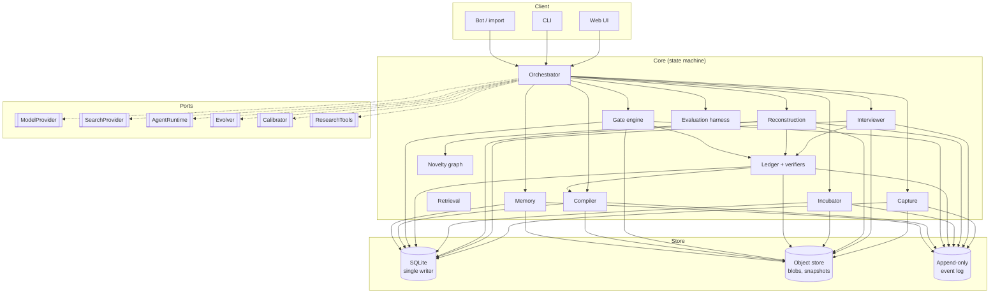
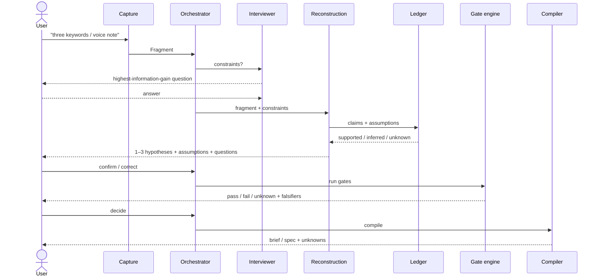

# Architecture

- Status: accepted
- Date: 2026-11-25
- Owner: HugoXK

This is the contract the reference runtime (`v0.2`) will be held to. It describes
the components, the state machine, the data model, the ports, the trust
boundaries and the failure modes. It is intentionally independent of any one
model, runtime or search vendor.

## Goals

1. **Develop, don't generate.** Every output carries hypotheses, assumptions,
   evidence and unknowns.
2. **Auditable.** Every claim is traceable to a source snapshot or marked
   `unknown`; every version is immutable.
3. **Local-first.** The core runs on one machine with SQLite and the user's keys.
4. **Portable.** Runtime, model, search, evolution and calibration are adapters.
5. **Honest.** The system prefers `defer` to a confident answer without evidence.
6. **Private.** Thoughts are sensitive; encryption, redaction and export are
   first-class.

## Non-goals

- Executing user code or repositories (a runtime does that).
- Autonomous publication, spend or external side effects.
- A general note editor or a chat product.
- A single-vendor agent framework.

## System overview



The **orchestrator** is the only component allowed to drive a state transition. It
writes an event for every transition; the event log is the audit trail.

## State machine

```
fragment ──capture──► captured
captured ──develop──► developed
developed ──incubate──► incubating
incubating ──promote──► verifying
verifying ──pass──► viable ──compile──► briefed
verifying ──fail──► parked | killed
viable ──outcome──► learned
```

| From | To | Exit condition | Writes |
|---|---|---|---|
| — | `captured` | A non-empty fragment with a timestamp | `Fragment` |
| `captured` | `developed` | ≥ 1 hypothesis, an assumption ledger, ≥ 1 question | `Idea` v1 |
| `developed` | `incubating` | The user opts in, or a schedule is set | `Idea` v2, schedule |
| `incubating` | `verifying` | A candidate has no load-bearing unconfirmed assumption | `Idea` v3, `Gate` set |
| `verifying` | `viable` | Every blocking gate is `pass` or explicitly `waived` by a human | `Gate` results |
| `verifying` | `parked` | A gate is `unknown` and more work is not justified | `Gate` results |
| `verifying` | `killed` | A gate is `fail` and no allowed fallback applies | `Gate` results |
| `viable` | `briefed` | The compiler passes all validators | `Brief` |
| `briefed` | `learned` | An outcome (approved, tested, shipped, abandoned) is recorded | `Outcome` |

**Rules**

- A state transition is atomic with its event; a failed transition leaves the prior
  state and writes a `transition_rejected` event with the reason.
- A new version of an idea never mutates an old version. Versions are immutable.
- A `pass` is tied to the evidence snapshot and the idea version; new evidence can
  invalidate it and moves the idea back to `verifying`.

## Components

### Capture

Accepts text, voice, image, link and sketch. It normalises to a `Fragment` with
provenance (`source`, `captured_at`, `language`). It must never require structure.
Voice is transcribed locally or through the configured provider; the raw audio is
kept unless the user deletes it.

### Interviewer

Maintains a `ConstraintState` and asks the question with the highest **expected
information gain**. It does not ask a fixed questionnaire. Each variable has a
value, a confidence, a source (`user`, `inferred`, `tool`, `default`) and an
optional evidence reference. The interviewer stops when the vertical's exit
condition is met, not when a list is exhausted.

The `v0.2` implementation is deliberately transparent:

- each question carries option priors;
- information gain is the Shannon entropy of those priors, discounted by the
  confidence already recorded for the variable;
- a blocking question gets a 3× weight, so a constraint that can stop the project
  is asked before a merely informative one;
- `answerConstraint` writes the variable, removes it from `unknowns`, and
  recomputes `blocking_unknowns`;
- `isReadyForVerification` is true only when every blocking question has a
  confident answer.

This is a heuristic, not a calibrated model. `v0.3` replaces the priors with
observed outcomes; the interface (`nextQuestion`, `blockingQuestions`,
`isReadyForVerification`) stays the same. The constraint state is stored per idea
in the `constraint_states` table.

### Reconstruction

Produces 1–3 hypotheses from a fragment plus the constraint state. For each
hypothesis it records:

- the statement and the variant (conservative / ambitious / cross-domain);
- the assumptions it had to make, with a risk (`low`/`medium`/`high`);
- the claims it relies on, each linked to the ledger;
- the open questions, ranked by information gain;
- a confidence, with a basis (`A`/`B`/`C`/`expert`).

It runs a **diversity pass**: multiple personas, a cross-domain analogy, and an
adversarial critic. The output is a candidate set, not a single answer.

A model adapter (`ModelReconstructor`) implements the same port. It enforces a
strict JSON contract: exactly three variants, non-empty assumptions and claims,
claims only `inferred`/`unknown`, and `confidence_basis: "C"`. A model is not a
source; a `verified` claim is rejected and repaired once. There is no silent
fallback to the template. See
[decisions/0006-model-adapter.md](decisions/0006-model-adapter.md).

### Incubator

A scheduled, background process. It connects a fragment or idea to:

- new evidence retrieved since the last run;
- other fragments and ideas in the user's memory;
- contradictions and near-duplicates;
- a periodic resurfacing ("this is relevant again").

It is a **proposal** engine: it writes a `connection` suggestion, never a silent
edit. It is implemented on the runtime port (for example, FlyBot schedules), but
the core defines the contract.

### Retrieval

A hybrid retrieval layer over the vertical's corpus and the user's memory:
keyword (BM25) + dense + reranker, with metadata filters. Every retrieved item is
stored with a snapshot (URL, title, fetched time, content hash, span). Retrieved
content is **untrusted**: it is data, never instructions.

### Ledger and verifiers

The claim ledger is the heart of the system. Each `Claim` has a value, unit,
conditions, status (`verified`, `inferred`, `unsupported`, `unknown`,
`contradicted`), confidence, confidence basis and sources. Verifiers check:

1. **Citation support** — does the cited span actually support the claim?
2. **Numeric consistency** — units, orders of magnitude, arithmetic.
3. **Existence** — does the referenced object exist (part, paper, company)?
4. **Contradiction** — is there a source that says the opposite?
5. **Freshness** — is the source still current for the vertical?

A brief cannot contain a `verified` claim without a passing citation check. A
failed check demotes the claim to `unsupported` and blocks compilation.

### Novelty graph

A typed graph of `Project`, `Part`, `Mechanism`, `Host`, `Readout`, `Substrate`,
`Evidence` and `Idea`. Novelty is a **structured comparison**, not an embedding
similarity:

- **Mechanism collision**: the mechanism node is the same or in the same family.
- **Interface whitespace**: the mechanism exists but the host, readout, sample
  type or quantification is new.
- **Sequence collision**: for biological parts, a BLAST-level check.

The output is a collision report: what collided, what did not, and where the
novelty must be argued. It is not a single "similar/different" score.

### Gate engine

Runs the vertical's gates. Each `Gate` has a criterion, a **falsifier** (what we
would see if we are wrong), controls, evidence, a status and an allowed fallback
(`change_readout`, `change_host`, `reduce_scope`, `compute_only`, `none`). Gates
are deterministic rules plus a rubric-based judge; a human decides any gate that
changes scope, spend or safety.

### Compiler

Emits a one-page brief or a spec. It runs four validators before writing:

- citation support (no unsupported claims);
- numeric consistency (units, conditions);
- object existence;
- vertical rules (for example, 2026 iGEM medal rules, loaded from a versioned
  config with a checked date).

The output always ends with an explicit **"what we still don't know"** section.

### Memory

A versioned idea graph plus a taste model:

- what the user accepted, edited or rejected;
- which assumptions were confirmed or refuted;
- which gates failed and why;
- which ideas reached a decided state.

The graph is implemented as typed, owner-scoped edges in SQLite (see
[decisions/0008-memory-graph.md](decisions/0008-memory-graph.md)): `derived_from`,
`references`, `supports`, `contradicts`, `supersedes`, `duplicates`,
`collided_with` and `outcome_of`. Every edge carries provenance and a timestamp; a
connection is explained by a bounded, deterministic path, not an embedding score.

Deletion is explicit. A fragment referenced by a live idea blocks deletion by
default; an explicit mark soft-deletes the fragment and its edges and records the
orphaned idea ids in the audit log. A fragment is never silently orphaned.

The taste model is used to bias reconstruction away from the user's known
rejections and away from the population average (anti-homogenisation). It is not
implemented in `v0.3`; it consumes recorded outcomes (#54, #28).

### Evaluation harness

Replay benchmarks, expert panels and calibration reports. See
[roadmap.md](roadmap.md).

## Data model

Canonical JSON Schema 2020-12 in [`../data/schemas/`](../data/schemas/):

| Schema | Object | Key fields |
|---|---|---|
| `fragment.schema.json` | `Fragment` | `id`, `captured_at`, `kind`, `content`, `privacy` |
| `constraint-state.schema.json` | `ConstraintState` | `variables[]` with `value`, `confidence`, `source` |
| `idea.schema.json` | `Idea` | `status`, `hypotheses[]`, `assumptions[]`, `claims[]`, `version` |
| `claim.schema.json` | `Claim` | `value`, `unit`, `conditions`, `status`, `confidence`, `sources[]` |
| `gate.schema.json` | `Gate` | `criteria`, `falsifier`, `evidence[]`, `status`, `fallback` |
| `brief.schema.json` | `Brief` | `one_liner`, `problem`, `approach`, `evidence`, `risks`, `unknowns` |
| `edge.schema.json` | `MemoryEdge` | `owner_id`, `from`, `to`, `relation`, `provenance`, `deleted_at` |
| `replay-case.schema.json` | `ReplayCase` | `metadata`, `constraints`, `fragment`, `prior_art`, `expected_candidates`, `collisions`, `gate_labels`, `outcome` |

The schemas are the source of truth. Every store write is validated against
`data/schemas/` with Ajv 2020-12 before it is persisted; the TypeScript types are
a convenience, not the contract. Generated types and a drift check are a `v0.3`
task. A change to a schema requires an ADR and a migration note.

## Storage

- **SQLite** (`node:sqlite`) as the single-writer store: users, fragments, ideas,
  constraint states, claims, gates, briefs, memory edges, schedules, outcomes,
  audit events. Shape changes run through ordered migrations tracked by
  `PRAGMA user_version`.
- **Object store** for blobs: audio, images, retrieved snapshots, compiled files.
  On a single machine this is a content-addressed directory (hash → file).
- **Append-only event log** for audit: `event_id`, `at`, `actor`, `type`,
  `subject`, `payload_hash`. The log is the source for replay and for the audit
  view.
- One writer per database. A move to Postgres is a local change behind the store
  port, not a rewrite.

## Ports and adapters

The core depends on interfaces, not vendors. Sketch:

```ts
export interface ModelProvider {
  complete(input: ModelInput): Promise<ModelOutput>;
  embed(input: string[]): Promise<number[][]>;
}

export interface SearchProvider {
  search(query: SearchQuery): Promise<SearchHit[]>;
  fetch(id: string): Promise<Snapshot>;
}

export interface AgentRuntime {
  schedule(job: ScheduledJob): Promise<JobRef>;
  cancel(ref: JobRef): Promise<void>;
}

export interface Evolver {
  propose(artifact: Artifact, dataset: Dataset): Promise<Candidate[]>;
  evaluate(candidate: Candidate, holdout: Dataset): Promise<Evaluation>;
}

export interface Calibrator {
  record(prediction: Prediction, outcome: Outcome): Promise<void>;
  curve(scope: Scope): Promise<CalibrationCurve>;
}

export interface ResearchTools {
  literature(query: string): Promise<Paper[]>;
  run(code: string, input: Blob): Promise<RunResult>;
}
```

Adapters shipped or planned: a local OpenAI-compatible model, a local search
index, FlyBot as `AgentRuntime`, AgentDescent as `Evolver`, a Janus-style ledger
as `Calibrator`, and ScienceDiscovery as `ResearchTools`.

**Frozen paths.** The ledger, the verifiers, the gate engine and the promotion
rule are frozen. An evolution candidate that changes them is rejected before
evaluation.

## Trust boundaries

| Boundary | Untrusted input | Control |
|---|---|---|
| Web/CLI → core | User text, files | Schema validation, size limits, rate limits |
| Retrieval → core | Web pages, papers, wikis | Treat as data; no instruction following; snapshot and cite |
| Core → model | Prompts containing private fragments | Per-provider consent; redaction; no training opt-in |
| Core → runtime | Job descriptors | Scoped token, signed callback, no repo write from core |
| Evolution → core | Candidate artifacts | Held-out gate, frozen paths, human approval |
| Vertical pack → core | Rules, templates | Versioned, checked date, schema-validated |

## Failure modes

| Failure | Symptom | Mitigation |
|---|---|---|
| Fabricated citation | A plausible source that does not support the claim | Span-level citation verifier; demote to `unsupported` |
| Fabricated object | A part or paper that does not exist | Existence check against the vertical's registry |
| Numeric drift | Units or orders of magnitude wrong | Unit normalisation and sanity bounds |
| Homogenised ideas | Three near-identical hypotheses | Diversity pass and a set-level diversity metric |
| Over-confident reconstruction | One answer presented as truth | Always ≥ 1 alternative; assumption ledger |
| Gate bypass | A judge "waives" a hard gate | Frozen gate engine; human-only waiver |
| Prompt injection | Retrieved text says "ignore previous instructions" | Data-only channel; instruction allowlist; no tool calls from retrieved text |
| Silent spend | Incubator or research runs cost money | Per-job budget, quota, and a hard stop |
| Data leak | Private fragment sent to a provider | Per-provider consent, local default, redaction |
| Stale rules | 2026 rules used in 2027 | Versioned config with a checked date; a startup warning |

## Sequence: fragment to brief



## Concurrency and idempotency

- One active development run per idea; a second run is rejected or queued.
- Every job has an idempotency key; a retry reuses the result.
- The event log is append-only; a correction is a new event, never an update.
- The incubator is a set of scheduled jobs with a per-job budget and a global cap.

## Observability

- Structured logs with claim/idea IDs, never fragment content by default.
- Counters: captures, developments, gate pass/fail/unknown, unsupported claims,
  deferred ideas, calibration error.
- The audit view is a product feature: the user can see every transition and every
  source snapshot.

## Testing

- **Schema tests**: every fixture validates against the schema.
- **Ledger tests**: a fabricated citation is rejected; a contradicted claim is
  demoted; a numeric unit mismatch is caught.
- **Gate tests**: a hard gate cannot be waived by a model.
- **Replay tests**: historical projects with a hidden outcome.
- **Adversarial tests**: prompt injection in retrieved text, homoglyph citations,
  plausible-but-fake objects.
- **End-to-end**: fragment → brief with a fake model and a local store, no network.

## Deployment

- **Local**: one process, SQLite, a content-addressed blob directory, the user's
  keys. Default.
- **Hosted**: the same code behind an auth layer, one writer per database, an
  object store, and a queue for the incubator.
- The core never runs user code. Scientific experiments go through the research
  adapter's sandbox, with explicit consent.

## Open questions

1. How do we version a source snapshot when the source changes?
2. What is the right unit of review for a team: an idea, a brief or a gate?
3. Can the taste model work without a population, and how do we avoid a filter
   bubble?
4. How much of the interviewer can be a deterministic rubric versus a model?
5. What is the smallest viable event log that still supports replay and audit?
